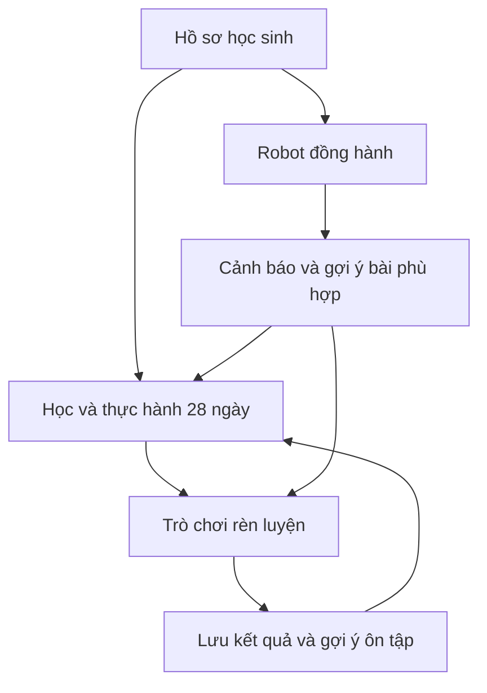
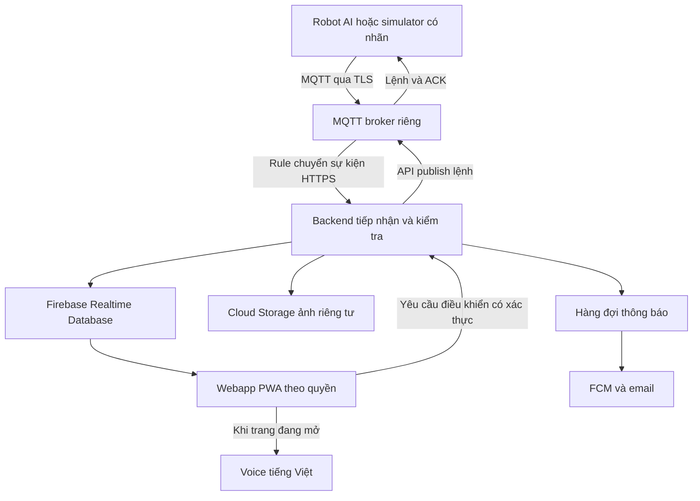

# Artifact triển khai BUGZ BrightUpGenZ trong 5 ngày

Phiên bản 1.0 · Ngày lập 01/11/2026 · Múi giờ Asia/Ho_Chi_Minh

Tài liệu dùng để hiểu luồng sản phẩm, chia công việc và giao việc lần lượt cho Google AI Studio. Sản phẩm là Webapp/PWA dùng trên máy tính, máy tính bảng và điện thoại, gồm ba module liên kết: **Học và thực hành 28 ngày**, **Robot đồng hành**, **Trò chơi rèn luyện**. Nền tảng dữ liệu được giữ đúng file Excel là **Firebase Realtime Database**; Robot truyền sự kiện qua **MQTT**.

Mục tiêu trong năm ngày là một bản dự thi có thể chạy và chứng minh từng luồng bằng dữ liệu thật. Việc hoàn thiện độ chính xác của mô hình nhận diện Robot phụ thuộc phần cứng và mô hình đã có; không đồng nhất việc hoàn thành Webapp với việc huấn luyện xong Robot.

Mốc lịch được hiểu là triển khai từ Chủ Nhật 01/11 đến Thứ Năm 05/11/2026, nộp Thứ Sáu 06/11/2026. Ngày đầu là một buổi ngắn; phần dự phòng đặt ở ngày cuối. Đây là kế hoạch thực hiện đề xuất, chưa phải báo cáo các chức năng đã lập trình hay đã kiểm thử.

## 1 Nguồn gốc nội dung và những gì đã xác minh

### 1.1 Ba file đầu vào

| Tài liệu | Điều đã đọc được | Vai trò trong triển khai |
|---|---|---|
| File Word yêu cầu ứng dụng | Luồng tuần, ngày, bóng đèn, huy chương; menu; liên kết tài liệu và ảnh; email Admin | Nguồn quy định hành vi và ánh xạ tài nguyên |
| Robot_Tu_the_4_bang_va_API.xlsx | Bốn sheet Users, Devices, Sessions, Alerts; trường dữ liệu và REST API Realtime Database | Hợp đồng dữ liệu gốc phải giữ |
| ERD.drawio | User một–nhiều Devices; Devices một–nhiều sessions; sessions một–nhiều alerts | Quan hệ logic; không phải ràng buộc khóa ngoại tự động của Firebase |

Đã đọc bản thuyết minh được dẫn trong Word: [Tài liệu dự án](https://docs.google.com/document/d/1u_QcKfS4_pAX27Q1pE6X5CbBvn5ENTLj/edit), tiêu đề trả về “ttnst đã sửa.docx”, gồm 158 đoạn văn. Đã đọc ảnh `full flashcard.png`, `in4 d1.png`, `day28.png` và kiểm kê được 104 file duy nhất qua [thư mục tài nguyên](https://drive.google.com/drive/folders/17jX1J0xhyvYG5lfKrTMu6fdViTQsg9M6).

Danh sách thư mục đầu tiên chỉ trả tối đa 100 mục. Vì vậy 104 là số mục đã xác minh qua các lần đọc, **không được hiểu là toàn bộ thư mục**. Trong số đã kiểm kê có đủ `day1.png` đến `day28.png`, có `in4 d1.png` đến `in4 d26.png` và `HC d1.png` đến `HC d27.png`. Chưa xác minh được `bg.png`, `logo1.png`, `Tuan3.png`, `Tuan4.png`, `in4 d27.png`, `in4 d28.png`, `HC d28.png`. Ngày 28 có bố cục riêng để gửi yêu cầu nhận chứng nhận; không tự tạo huy chương hay nội dung chuyên môn thay cho tài nguyên chưa xác minh.

Có sai khác tên cần xử lý bằng manifest: Word gọi `Baochi.png`, danh sách trả về `Bao.png`; Word gọi `Chip CV.png`, danh sách trả về `chip CV.png`; `in4 Leade.png` và file thực tế `in4 leade.png` khác cách viết hoa. Không đổi liên kết theo suy đoán. Manifest giữ tên gốc, Drive ID và tên dùng trong mã, kiểm tra từng cặp trước khi nhập.

### 1.2 Nguyên tắc giữ đúng 100 phần trăm nội dung

“100 phần trăm” được nghiệm thu bằng **độ bao phủ và đối chiếu tài liệu**, không bằng việc AI tự viết đủ 28 bài tương tự. Mỗi ngày phải có nguồn xác định, ảnh gốc, phần giải thích gốc nếu có, hành động thực hành, huy chương hoặc luồng kết thúc tương ứng. Văn bản OCR chỉ xuất bản sau khi so sánh với ảnh gốc. Ảnh gốc không bị vẽ lại hoặc chèn chữ đè lên nội dung.

Các câu hỏi, lời nhắc hài hước và ảnh hoạt hình mới là **lớp bổ sung**, có nhãn nguồn, không được gắn là lời bác sĩ hay nội dung gốc. Giữ nguyên bản lưu trữ không có nghĩa là mọi khẳng định sức khỏe trong tài liệu đã được kiểm chứng độc lập. Ví dụ giải thích ở `in4 d1.png` có các khẳng định về cơ chế bệnh lý cần người có chuyên môn rà soát; số liệu khảo sát trong thuyết minh cũng chỉ được trình bày là số liệu do dự án báo cáo.

Đối với ngày 11, 12, 16 và mọi nội dung thao tác quanh mắt hoặc cổ, giữ nguồn gốc đầy đủ nhưng đặt cờ `needs_clinical_review` cho hướng dẫn thực hành mới hoặc bản diễn giải lại. Không tự tạo câu hỏi khuyến khích ấn mắt, rửa trực tiếp nhãn cầu, xoay cổ mạnh hoặc hứa ngăn/chữa cận thị. Bộ 40 câu hỏi kèm theo chọn các kiến thức cơ bản có thể đối chiếu được; chưa phải chứng nhận thẩm định y khoa.

### 1.3 Tham khảo HistoriAI

Đã trực tiếp mở [historiai.org](https://historiai.org/) ở chế độ dùng thử. Quan sát được onboarding, thẻ gợi ý học theo bước, chuỗi ngày, điểm, cấp độ; Đấu trường có thẻ chủ đề ghi số câu và thời gian mỗi câu; một lượt chơi hiển thị câu hiện tại, đáp án và lời giải ngay khi trả lời hoặc hết giờ.

Áp dụng cho BUGZ: chủ đề rõ ràng, lượt chơi ngắn, phản hồi ngay, xem lại kiến thức và tiến độ cá nhân. Không sao chép nội dung lịch sử, thương hiệu, mã nguồn hoặc giả định có những chức năng chưa quan sát. Trò chơi BUGZ dùng ngân hàng câu hỏi đã duyệt; không cần gọi AI trực tiếp để sinh đáp án khi học sinh chơi.

## 2 Phạm vi bản dự thi

| Nhóm | Phải có trong bản dự thi | Mở rộng sau khi nộp |
|---|---|---|
| Nội dung | Đủ đường dẫn 4 tuần và 28 ngày; dữ liệu gốc đã đối chiếu; flashcard; giải thích; huy chương; ngày 28 | Tìm kiếm ngữ nghĩa, biên tập đa ngôn ngữ |
| Robot | Ghép thiết bị; chọn học sinh; bắt đầu/kết thúc phiên; MQTT thật; trạng thái; ảnh; lịch sử; bộ đếm | Đa người trong khung hình; tự theo dõi khi Robot di chuyển; cải tiến mô hình |
| Thông báo | Push trên thiết bị đã cho phép; voice trong phiên đang mở; email đến địa chỉ đã xác minh; nhật ký từng kênh | Ứng dụng native nếu cần voice khi đóng app; nhiều nhà cung cấp email |
| Trò chơi | 40 câu seed; ba kiểu tương tác; minh họa đồng bộ; giải thích; kết quả; liên kết về bài học | Multiplayer, phòng thi của lớp, bảng xếp hạng công khai |
| Tài khoản | Google Login; SuperAdmin, Phụ huynh, Học sinh; quyền dữ liệu theo quan hệ | Vai trò giáo viên và tổ chức trường học |
| Admin | Quản lý tài khoản, liên kết con, Robot, bài học, câu hỏi, ảnh, thông báo, yêu cầu chứng nhận, audit | Báo cáo vận hành quy mô lớn, phân quyền tùy biến |
| Chất lượng | PWA qua HTTPS, responsive, kiểm thử quyền và luồng tích hợp, hồ sơ bằng chứng | Đánh giá lâm sàng và nghiên cứu hiệu quả dài hạn |

Không bỏ các yêu cầu push, email, ảnh hay phân quyền để gọi bản giao diện là hoàn tất. Nếu một tích hợp chưa chạy thật, bảng trạng thái phải ghi “chưa đạt” và có bước xử lý rõ ràng. Có thể dùng simulator để phát MQTT khi Robot chưa ổn định, nhưng phải hiển thị **Nguồn mô phỏng** và không trình bày là nhận diện thực tế.

## 3 Luồng sản phẩm giữa ba module



Một ví dụ xuyên suốt: học sinh học ngày 1 về tư thế → chủ động bắt đầu phiên Robot → Robot báo đợt cúi đầu đã vượt ngưỡng cấu hình → ứng dụng hiện lời nhắc và liên kết đến ngày có kiến thức liên quan → học sinh chỉnh tư thế → Robot xác nhận đã trở lại trạng thái tốt → học sinh có thể chơi một lượt câu hỏi về tư thế. Bấm “đã chỉnh” chỉ là tự xác nhận; trạng thái Robot chỉ thay đổi khi có tín hiệu mới đáng tin cậy.

Ba loại tiến bộ luôn tách biệt: **hoàn thành tự báo cáo**, **kết quả trò chơi**, **quan sát Robot**. Không dùng điểm trò chơi để suy ra sức khỏe; không dùng việc bấm huy chương làm bằng chứng Robot đã xác nhận tư thế.

## 4 Người dùng và phân quyền

| Chức năng | SuperAdmin | Phụ huynh | Học sinh |
|---|---|---|---|
| Xem nội dung đã xuất bản và chơi | Có | Có | Có |
| Quản lý bài, ảnh, câu hỏi, xuất bản | Toàn dự án | Không | Không |
| Xem học sinh và lịch sử | Theo quyền quản trị được ghi audit | Chỉ con đã liên kết | Chỉ hồ sơ của mình |
| Ghép Robot và cấu hình cảnh báo | Quản lý và thu hồi thiết bị | Robot thuộc quyền gia đình | Không tự nhận quyền sở hữu |
| Bắt đầu phiên Robot | Có quyền hỗ trợ | Chọn con đã liên kết | Chỉ phiên của mình trên Robot được cấp |
| Đổi vai trò và khóa tài khoản | Qua backend tin cậy | Không | Không |
| Gửi yêu cầu chứng nhận | Xử lý yêu cầu | Cho con đã liên kết | Gửi yêu cầu của mình |
| Xem ảnh capture | Có mục đích hỗ trợ, có audit | Chỉ ảnh của con đã liên kết | Chỉ ảnh của mình |

Google Login đi qua Firebase Authentication. Đăng nhập lần đầu không được tự nhận SuperAdmin bằng nút chọn vai trò. Email Admin trong Word là `minhquantran4312@gmail.com`; dùng làm danh sách bootstrap phía server. Backend xác minh Google ID token, email đã xác minh và UID, sau đó mới cấp custom claim `superadmin`. Frontend không có quyền tự ghi claim.

Phụ huynh có thể có nhiều hồ sơ con và nhiều Robot. Hồ sơ học sinh dùng `student_id` ổn định; nếu học sinh có tài khoản Google được phép sử dụng thì liên kết `auth_uid` với hồ sơ. Khi trẻ chưa có tài khoản phù hợp, dùng hồ sơ con do phụ huynh quản lý; không hướng dẫn lách điều kiện độ tuổi của Google. Phiên sử dụng chung thiết bị của phụ huynh cần chuyển sang chế độ học sinh và xác thực lại trước khi mở khu vực quản lý.

Liên kết phụ huynh–học sinh dùng lời mời một lần, hết hạn, kiểm tra qua backend. Không cho người dùng nhập một `student_id` bất kỳ để xem dữ liệu. Mỗi phiên Robot phải được gán đúng học sinh trước khi giám sát; không dùng nhận diện khuôn mặt làm điều kiện của bản dự thi.

## 5 Module học và thực hành 28 ngày

### 5.1 Luồng màn hình bắt buộc

Trang chủ → chọn tuần → chọn ngày → xem flashcard chính → bấm bóng đèn để xem giải thích → thực hành → bấm biểu tượng huy chương góc dưới trái để tự xác nhận → xem huy chương ngày tương ứng → tiếp ngày sau. Nút bóng đèn giữ ở góc dưới phải trong vùng thao tác, không đè vào chữ của ảnh.

Tại ngày 7, 14, 21, nút tiếp đưa đến ngày 8, 15, 22 và cập nhật tuần tương ứng. Ngày 28 dẫn đến màn hình **Yêu cầu nhận chứng nhận**, không dẫn đến ngày 29. Giữ chức năng gửi yêu cầu qua email theo tài liệu gốc; bổ sung bản ghi yêu cầu trong hệ thống để Admin theo dõi. Người dùng duyệt nội dung trước khi gửi; hệ thống không tự cấp một chứng nhận chuyên môn hay giả chữ ký.

Nguồn gốc ngày 28 yêu cầu ảnh và cảm nghĩ. Form nhận ảnh thành quả, lời chia sẻ ngắn, email người nhận chứng nhận; với trẻ dùng thông tin liên hệ do phụ huynh quản lý. Dữ liệu gửi Admin được giới hạn theo mục đích. Hiển thị trạng thái đã nhận, đang xử lý, đã hoàn thành.

### 5.2 Tiến độ và hành vi

- Mỗi ngày có trạng thái chưa bắt đầu, đang xem, tự xác nhận đã thực hành. Lưu thời điểm và phiên bản bài; nhận huy chương nhiều lần không cộng thành nhiều ngày hoàn thành.
- Cho phép xem lại và đi tới các ngày theo menu gốc; không tự áp dụng khóa ngày mà nguồn không yêu cầu. Gợi ý “ngày nên học tiếp” chỉ là hướng dẫn.
- Có phần hướng dẫn thao tác và checklist lấy nguyên văn từ nguồn đã duyệt. Không tự suy diễn lịch tập, số lần tập hoặc thời gian tập từ tiêu đề.
- Huy chương lưu theo `student_id + day_number`; khi đồng bộ lại chỉ cập nhật cùng một bản ghi. Có thể tải ảnh huy chương gốc, không tự thêm chứng nhận sức khỏe.
- Phiên tự thực hành vẫn dùng được khi không có Robot. Chỉ hiển thị mục Robot xác nhận nếu phiên Robot thực sự có dữ liệu tương ứng.

### 5.3 Bản đồ nội dung 28 ngày đã đọc từ ảnh tổng hợp

| Ngày | Tuần | Tiêu đề trong tài nguyên | File trang chính |
|---|---|---|---|
| 1 | 1 | Ngồi thẳng nào | day1.png |
| 2 | 1 | Khoảng cách 30cm | day2.png |
| 3 | 1 | Mắt nhìn ngang tầm | day3.png |
| 4 | 1 | Ánh sáng vừa đủ | day4.png |
| 5 | 1 | Bàn ghế vừa tầm | day5.png |
| 6 | 1 | Không nằm đọc | day6.png |
| 7 | 1 | Thử thách đầu tiên | day7.png |
| 8 | 2 | 20-20-20 | day8.png |
| 9 | 2 | Chớp mắt 10 lần | day9.png |
| 10 | 2 | Nhìn xa gần | day10.png |
| 11 | 2 | Massage mắt | day11.png |
| 12 | 2 | Rửa mắt bằng nước mát | day12.png |
| 13 | 2 | Hạn chế màn hình sau 21h | day13.png |
| 14 | 2 | Nhìn xanh cho mắt khỏe | day14.png |
| 15 | 3 | Vươn vai mỗi giờ | day15.png |
| 16 | 3 | Xoay cổ nhẹ nhàng | day16.png |
| 17 | 3 | Chống đẩy tường | day17.png |
| 18 | 3 | Đi lại một phút | day18.png |
| 19 | 3 | Đặt lại bàn học | day19.png |
| 20 | 3 | Tư thế khi viết | day20.png |
| 21 | 3 | Nhóm bạn cùng thẳng lưng | day21.png |
| 22 | 4 | Kiểm tra tư thế bản thân | day22.png |
| 23 | 4 | Ghi nhật ký cảm giác mắt | day23.png |
| 24 | 4 | Chia sẻ mẹo của bạn | day24.png |
| 25 | 4 | Sáng tạo flashcard riêng | day25.png |
| 26 | 4 | Nhắc bạn cùng làm | day26.png |
| 27 | 4 | Không Flashcard | day27.png |
| 28 | 4 | Nhận chứng nhận Mắt sáng Lưng thẳng | day28.png |

Tên tiêu đề trong bảng đã bỏ một số dấu câu để dễ đọc; ảnh gốc mới là bản đối chiếu nguyên văn. Không coi các mốc như sau 21h hoặc số lần trong tiêu đề là hướng dẫn phổ quát cho mọi lứa tuổi, tình trạng sức khỏe hay thiết bị.

### 5.4 Thư viện và menu giữ từ bản gốc

Flashcard: xem ảnh tổng `full flashcard.png`, có phóng to và di chuyển; đồng thời có lối mở từng ngày. BOT AI: mở đúng liên kết GPT được cung cấp; đây là điều hướng ra ChatGPT, không phải một API chatbot đã tích hợp. Báo chí: sáu thẻ điều hướng đúng sáu URL trong phụ lục. Đội ngũ: giữ mapping thành viên, hồ sơ, liên hệ. Chứng nhận chuyên môn: bốn ảnh nguồn, slideshow next/previous/pause và phóng to; không dựng lại giấy chứng nhận. Cộng đồng: mở trang Facebook nguồn. Hỗ trợ: hiển thị kênh có thật từ nguồn đã xác minh, không tạo hotline mới.

## 6 Module Robot đồng hành

### 6.1 Luồng sử dụng

Phụ huynh ghép Robot bằng mã thiết bị và mã ghép một lần → backend kiểm tra thiết bị chưa thuộc gia đình khác → chọn con → xác nhận vị trí Robot và kiểm tra khung hình → bắt đầu phiên → gửi yêu cầu giám sát → Robot phản hồi đã bật → màn hình hiển thị tư thế và kết nối → phát cảnh báo khi có đợt sai đủ điều kiện → kết thúc phiên và lưu tổng hợp.

`monitoring_enabled` là **yêu cầu từ ứng dụng**. `monitoring_active` là **Robot đã xác nhận**. Khi bật nút mà Robot chưa ACK, UI phải ghi “Đang chờ Robot”, không ghi “Đang giám sát”. Tắt giám sát cũng chờ phản hồi; nếu hết thời gian thì hiển thị chưa xác nhận.

### 6.2 Robot di chuyển và độ tin cậy

Khi Robot đang di chuyển, góc nhìn thay đổi hoặc mất chuẩn, trạng thái là `unknown` và tạm dừng phát hiện đợt sai. Chỉ tiếp tục sau khi Robot dừng, kiểm tra đủ người trong khung hình và hiệu chuẩn lại. Không mặc định một camera RGB có thể đo khoảng cách mắt–sách chính xác bằng cm nếu chưa có thước chuẩn, độ sâu hoặc quy trình hiệu chuẩn.

Đầu vào tối thiểu: kết quả tư thế, mã lý do nếu mô hình có hỗ trợ, độ tin cậy, thời điểm, mã phiên, mã sự kiện và trạng thái di chuyển. Nếu firmware hiện chỉ trả `good/bad`, phần lý do phải ghi “Tư thế chưa phù hợp”; không bịa gù lưng, cúi đầu hay khoảng cách từ giá trị `bad`.

Bốn trạng thái giữ nguyên Excel: `good`, `bad`, `absent`, `unknown`. Không có người và không xác định không bị tính là sai. Không đổi kết quả mô hình thành chẩn đoán cận thị, gù cột sống hoặc vẹo cột sống.

### 6.3 Định nghĩa đợt và bộ đếm

Đợt là một trạng thái ổn định đã được xác nhận, không phải từng khung hình. Chuỗi đúng → sai → đúng → sai cho `good_count = 2`, `bad_count = 2` đúng quy ước Excel. Một đợt sai có thể có nhiều lần nhắc, nên **số cảnh báo không bằng bad_count**.

Thông số dưới đây là cấu hình kỹ thuật thử nghiệm đề xuất: xác nhận trạng thái ổn định trong 3 giây; bắt đầu cảnh báo sau `alert_after_sec = 30`; nhắc lại tối thiểu 60 giây; xác nhận trở lại trạng thái tốt sau 3 giây. Không coi các giá trị này là ngưỡng y khoa. Firmware hoặc bridge là nơi duy nhất vận hành máy trạng thái; không cho cả hai cùng phát đợt độc lập.

Bản dự thi chọn **bridge làm nơi quyết định đợt** nếu Robot phát được quan sát đủ thường xuyên. Nếu firmware đã tính đợt ổn định, adapter nhận `episode.started/episode.ended` và tắt máy trạng thái ở bridge. Quyết định này được đóng băng ở ngày 1 trong `integration_decisions.md`.

Với chế độ bridge, `absent`, `unknown`, Robot di chuyển, mất kết nối hoặc thiếu mẫu quá thời gian cấu hình làm gián đoạn khoảng sai liên tục; không tự kéo dài sai qua khoảng không quan sát. Nếu quay lại sau gián đoạn, tạo đợt mới khi đủ ổn định. Kết thúc phiên đóng đợt đang mở. Mỗi Robot tối đa một phiên học mở; Robot khởi động lại phải đồng bộ lại phiên.

### 6.4 Lịch sử và mức độ

Mỗi cảnh báo có thời gian, học sinh, thiết bị, phiên, nội dung, loại tư thế nếu biết, mức nhắc, độ tin cậy nếu có, ảnh và trạng thái gửi các kênh. Mức `low/medium/high` là mức ưu tiên nhắc của hệ thống; chưa phải mức tổn thương cơ thể.

Có thể cấu hình mức theo thời gian sai kéo dài và số lần lặp, ví dụ 30/60/120 giây để thử kỹ thuật. Chỉ bật sau khi thống nhất định nghĩa; không yêu cầu Robot tự xuất mức mà mô hình chưa có. Không dùng màu đỏ hoặc câu chữ gây sợ để kết luận học sinh bị bệnh.

Ảnh chụp được tải riêng qua HTTPS vào Cloud Storage. MQTT chỉ gửi mã ảnh và metadata. Không đẩy base64 ảnh vào Realtime Database hoặc gói MQTT thông thường. Khi chưa có ảnh: hiển thị “Ảnh đang xử lý” hoặc “Không có ảnh”; khi tải thất bại vẫn giữ cảnh báo, không dựng ảnh học sinh thay thế.

### 6.5 Lọc và thống kê

Lọc theo giờ, ngày, tuần, tháng, năm và khoảng tùy chọn; bổ sung học sinh, Robot và mức nhắc. Giờ/ngày/tuần hiển thị theo múi giờ hồ sơ, mặc định Việt Nam. Tuần bắt đầu Thứ Hai. Backend lưu số mili giây UTC và giữ riêng giờ Robot báo với giờ server nhận.

Đếm: số đợt đúng, số đợt sai, số cảnh báo, số phiên và số ngày hoàn thành. Tỷ lệ thời gian ngồi đúng chỉ xuất hiện nếu có đo duration hợp lệ; không lấy `good_count / (good_count + bad_count)` rồi gắn nhãn tỷ lệ thời gian. Các bộ đếm về đợt dùng thời điểm bắt đầu đợt; đợt qua nửa đêm không bị nhân đôi. Lọc cảnh báo dùng thời điểm sự kiện đã chuẩn hóa.

## 7 Push voice và email theo hồ sơ

### 7.1 Định tuyến người nhận

Một sự kiện được ánh xạ: `device_id` đã xác thực → phiên đang mở → `student_id` đã gán → tài khoản học sinh và danh sách phụ huynh đã liên kết → thiết lập kênh của từng người. Không lấy email hay `student_id` trong payload làm nguồn phân quyền. Một phụ huynh có nhiều con phải thấy tên hồ sơ đúng trong nội dung riêng tư sau đăng nhập.

| Kênh | Cách chạy | Điều kiện và hành vi dự phòng |
|---|---|---|
| Trong ứng dụng | Listener Realtime Database, banner và hộp thư | Luôn có khi đăng nhập và có mạng, kể cả bị từ chối push |
| Push | Firebase Cloud Messaging, service worker, token theo tài khoản và thiết bị | HTTPS, trình duyệt hỗ trợ, người dùng cho phép; bấm mở đúng cảnh báo |
| Voice | Clip tiếng Việt đã chuẩn bị hoặc Web Speech trong trang đang mở | Có nút Bật lời nhắc và kiểm tra âm thanh; giọng Việt tùy thiết bị; luôn có nút Nghe lại |
| Email | Backend gọi nhà cung cấp email giao dịch hoặc SMTP đã cấu hình | Địa chỉ đã xác minh, lựa chọn nhận của hồ sơ, gửi có log và retry có giới hạn |

Đáp ứng yêu cầu ba kênh bằng một policy rõ ràng: mỗi cảnh báo hợp lệ tạo job push và email cho người đã bật kênh tương ứng; trang học đang mở phát voice khi đã cho phép âm thanh. Bản demo bật chế độ email từng cảnh báo trên tài khoản kiểm thử đã đồng ý; bản dùng thực tế cho phụ huynh chọn từng cảnh báo hoặc bản tổng hợp và có giờ yên lặng. Không tự đổi yêu cầu email thành một báo cáo cuối ngày mà không nêu rõ.

Không thể cam kết voice tự đọc khi PWA đã đóng hoặc bị hệ điều hành treo. Khi chạy nền dùng push của hệ điều hành; khi mở lại hiện lời nhắc và nút nghe. iPhone/iPad cần kiểm tra phiên bản, khả năng hỗ trợ và điều kiện cài lên Màn hình chính; không chỉ kiểm thử trong cửa sổ preview AI Studio.

### 7.2 Trạng thái giao nhận

Lưu riêng `queued`, `accepted_by_provider`, `failed`, `suppressed`, và trạng thái mở nếu có tín hiệu. FCM trả message ID chỉ chứng minh dịch vụ đã nhận yêu cầu; không đồng nghĩa học sinh đã nhìn thấy. Email accepted không đồng nghĩa đã đọc. `alerts.is_read` theo Excel là việc phụ huynh đọc trong app; không dùng làm trạng thái FCM. Bổ sung `notification_reads/{uid}/{alert_id}` để biết người nào đọc.

Cùng một `alert_id` có thể đến từ listener và FCM; frontend hợp nhất thành một thẻ và chỉ đọc voice một lần trong phiên trình duyệt. Token FCM được gắn với UID, cập nhật khi đổi token và gỡ liên kết khi đăng xuất thiết bị dùng chung. Nội dung lock screen và email không chứa ảnh capture, bệnh lý hay thông tin nhạy cảm; xem chi tiết qua đường dẫn cần đăng nhập.

### 7.3 Ngôn ngữ nhắc mẫu

- “Lưng mình xin một chỗ tựa nhé. Thả lỏng vai rồi ngồi ngay ngắn nào!”
- “Cuốn vở chưa chạy mất đâu! Mình đưa mắt ra xa một chút theo hướng dẫn nhé.”
- “Vai đang trực hơi căng rồi. Thả lỏng một nhịp cùng mình nào!”
- “Mắt xin một vé nhìn xa. Tạm dừng việc gần một chút nhé!”
- “Góc học tập muốn lên hạng rồi. Mình chỉnh lại bàn ghế cho vừa nào!”
- Khi Robot xác nhận tốt trở lại: “Đã nhận tín hiệu ổn hơn rồi! Cảm ơn bạn đã chỉnh lại nhé.”

Không dùng lời chê hình thể, đe dọa, chế giễu hoặc gán bệnh. Lời khích lệ có thể vui nhưng động tác sửa phải cụ thể và đúng với mã tư thế đã biết.

## 8 Module trò chơi rèn luyện

### 8.1 Vòng chơi

Chọn chủ đề → xem mục tiêu và luật → chơi 5 câu hoặc một nhiệm vụ ngắn → chạm/kéo thả/chọn theo tình huống → phản hồi ngay → thử lại hoặc xem bài gốc → xem kết quả → nhận điểm học tập → gợi ý ngày cần ôn. Mỗi câu ghi rõ một đáp án đúng, có giải thích và nguồn bài.

Không bắt trẻ chơi thật nhanh để chứng minh hiểu; mặc định không giới hạn giờ. Có chế độ tùy chọn 30 giây cho trải nghiệm thử thách, tắt được. Sai không mất ngày thực hành, không bị bêu tên. Khuyến khích dừng màn hình và thực hành thật giữa các lượt chơi.

### 8.2 Ba kiểu tương tác cùng một module

| Kiểu chơi | Cách tương tác | Nguồn và đầu ra |
|---|---|---|
| Chọn cách xử lý | Một tình huống và ba đáp án; nhấn đáp án nhận lời giải ngay | 40 câu seed, chủ đề Lưng thẳng và Mắt sáng; lưu đáp án, lần thử |
| Sắp góc học tập | Kéo hoặc chạm chọn thẻ đèn, bàn, ghế, kê chân, sách vào khu vực phù hợp; có thao tác bàn phím tương đương | Ngày 4, 5, 19; đáp án dựa nguyên tắc đã duyệt, không chấm từ ảnh AI |
| Tiếp sức thói quen | Chọn thẻ hành động phù hợp với câu chuyện, xếp bước chuẩn bị góc học và nghỉ ngắn; phần thực hành được tự xác nhận | Ngày 1, 8, 15, 18, 26; không coi việc bấm nút là Robot đã quan sát |

Điểm đề xuất: 10 điểm cho một câu trả lời đúng lần đầu; lần thử sau nhận lời khen và ghi nhận đã hiểu nhưng không cộng vô hạn. Kết quả lưu theo attempt và phiên bản câu hỏi. Không công khai bảng xếp hạng trẻ em trong bản thi. Huy chương 28 ngày giữ riêng với điểm game.

### 8.3 Ngân hàng câu hỏi và hình minh họa

Gói kèm có `question_bank.json` gồm 40 câu, chia đều hai chủ đề, có đáp án, lời giải, phản hồi sai nhẹ nhàng, ngày nguồn và tham chiếu khoa học khi cần. Tất cả là bản biên soạn mới; trạng thái `editorial_draft`, cần người phụ trách duyệt trước khi xuất bản cho học sinh. Việc kiểm tra cấu trúc JSON không phải thẩm định y khoa.

Ảnh `bugz_learning_atlas.png` là một atlas 2×2 đã tạo: tư thế đọc thoải mái, bàn ghế và ánh sáng, nghỉ mắt nhìn xa, nghỉ vận động. Có cùng cặp nhân vật nam–nữ xuyên suốt. Mỗi câu tham chiếu một ô qua `illustration_id`; dùng CSS background-position hoặc clip vùng hiển thị từ file nguồn. Đây là hình theo chủ đề để dẫn chuyện, không phải 40 tranh khác nhau và không dùng để đo góc hay khoảng cách.

Khóa thiết kế đề xuất cho phần mới: nhân vật nam áo polo xanh teal, tóc nâu ngắn; nhân vật nữ tóc bob nâu có kẹp vàng, váy coral; hoạt hình 3D chất liệu mờ, ánh sáng dịu, nền lớp học sáng, màu teal–mint–kem. Chưa đặt tên nhân vật thành viên dự án. Không thay các nhân vật, logo hoặc tài nguyên gốc khi chưa có yêu cầu. Prompt gốc nằm trong `ILLUSTRATION_SPEC.md`.

## 9 Sitemap và thiết kế giao diện

### 9.1 Điều hướng

Mobile có ba tab chính: **Học 28 ngày**, **Robot**, **Trò chơi**. Avatar mở hồ sơ, hộp thư và thiết lập; menu bổ sung chứa Flashcard, BOT AI, Báo chí, Đội ngũ, Chứng nhận chuyên môn, Cộng đồng, Hỗ trợ. Phụ huynh có bộ chọn con luôn nhìn thấy ở khu quản lý. Desktop dùng sidebar với đúng ba nhóm module tương ứng. Admin có giao diện riêng, không nhét tất cả công cụ vào giao diện học sinh.

| Tuyến đề xuất | Màn hình và hành động chính |
|---|---|
| /login | Google Login, giải thích dữ liệu và quyền thông báo |
| /onboarding | Chọn loại tài khoản phù hợp, liên kết phụ huynh–con |
| /learn | Tiếp tục ngày đang học, tổng tiến độ |
| /learn/weeks/:week | Danh sách bảy ngày, ảnh nguồn tương ứng |
| /learn/days/:day | Flashcard, bóng đèn, tự thực hành, huy chương |
| /learn/days/:day/info | Giải thích nguồn, quay lại đúng ngày |
| /learn/days/:day/medal | Ảnh huy chương và ngày tiếp theo |
| /certificate-request | Yêu cầu nhận chứng nhận sau ngày 28 |
| /robot | Kết nối, học sinh hiện tại, phiên và trạng thái |
| /robot/history | Lọc lịch sử và bộ đếm |
| /alerts/:alertId | Đúng cảnh báo, ảnh có quyền, bài gợi ý |
| /games | Chủ đề, kiểu chơi, mức phù hợp |
| /games/play/:gameId | Lượt chơi tương tác |
| /games/results/:attemptId | Giải thích, điểm và xem bài gốc |
| /library/:section | Flashcard, báo chí, đội ngũ, chứng nhận |
| /parent | Hồ sơ con, tiến độ, Robot và thiết lập nhận tin |
| /admin | Quản trị theo các nhóm công việc bên dưới |

Đường dẫn là đề xuất để AI Studio dựng, không phải URL đã tồn tại. Mọi liên kết từ tìm kiếm, câu hỏi, push và email phải tới đúng bản ghi; khi chưa đăng nhập lưu đường dẫn đích và mở lại sau đăng nhập. Nếu không đủ quyền, hiện thông báo phù hợp, không rơi về trang chủ như thể đã mở nội dung.

### 9.2 Quy tắc UI

Thân thiện với học sinh tiểu học và THCS nhưng không quá nhiều hiệu ứng. Giữ tinh thần màu và ảnh nguồn; lớp thao tác mới dùng nền sáng, bo góc nhẹ, chữ tiếng Việt dễ đọc, cỡ thân bài khoảng 16–18px trên mobile và nút chạm tối thiểu 44px. Không dùng màu là dấu hiệu duy nhất để phân biệt đúng sai. Có focus bàn phím, nhãn nút bóng đèn/huy chương, phụ đề lời nhắc và chế độ giảm chuyển động.

Đảm bảo xem ảnh dọc không bị cắt nội dung, không kéo dãn méo; ảnh lớn có zoom và mô tả văn bản đã đối chiếu. Giao diện hoạt động ở 360px, 390px, 768px và 1440px, cả tablet ngang. Lịch sử có trạng thái chưa có dữ liệu, mất kết nối, ảnh lỗi và không đủ quyền; không lấp các trạng thái này bằng số liệu giả.

## 10 Kiến trúc triển khai



Frontend đề xuất React, TypeScript và Vite; dùng thư viện UI vừa đủ, không đổi framework giữa chừng. Firebase cung cấp Authentication, Realtime Database, Storage, Cloud Functions và Hosting. FCM phục vụ push. Email cần nhà cung cấp giao dịch/SMTP; Firebase Authentication không tự gửi email cảnh báo tư thế.

**Phương án MQTT ưu tiên cho bản nộp:** broker có Rule Engine/webhook để chuyển sự kiện MQTT sang HTTPS và có API publish lệnh. Backend là HTTP function ngắn hạn; không chạy vòng subscriber vô hạn trong Cloud Functions. Tài khoản broker và gói dịch vụ thực tế phải kiểm tra được cả hai khả năng ngay ngày 1. Không mặc định mọi gói broker đều hỗ trợ.

**Phương án thay thế nếu broker không có webhook:** một bridge Node.js dùng MQTT client, chạy trên máy luôn bật trong lúc thi hoặc dịch vụ worker phù hợp. Nếu chạy trên laptop, hồ sơ bàn giao phải nêu phụ thuộc laptop và mạng; chưa được gọi là backend độc lập luôn sẵn sàng. Nếu chọn Cloud Run phải cấu hình cho tác vụ nền, không dựa vào container có thể scale về 0 sau request. Chỉ chọn một adapter cho bản nộp, giữ cùng hợp đồng sự kiện để không sửa UI.

AI Studio dùng để sinh và chỉnh mã. Có thể dùng runtime Node của Build mode để thử API; không mặc định preview sẽ giữ một MQTT subscriber sống liên tục hoặc tự cấp quyền Firebase/MQTT. Bản nộp Webapp dùng HTTPS triển khai thật; cấu hình Firebase và broker được thực hiện trong console tương ứng.

## 11 Cấu trúc dữ liệu Firebase

### 11.1 Bốn nhóm gốc được giữ

| Nhóm và đường dẫn | Trường gốc | Quy ước quan trọng |
|---|---|---|
| users/{uid} | full_name string; email string | uid là khóa nhánh, do Firebase Auth cấp; user_id không cần lặp |
| devices/{device_id} | user_id string; device_name string; monitoring_enabled boolean; current_posture string; monitoring_active boolean; alert_after_sec integer; last_seen_at number ms | user_id vẫn là UID phụ huynh sở hữu; current_posture chỉ nhận good/bad/absent/unknown |
| sessions/{device_id}/{session_id} | device_id string; started_at number ms; ended_at number ms nếu đã đóng; good_count integer; bad_count integer | Mỗi Robot tối đa một phiên mở; bộ đếm không âm; ended_at không nhỏ hơn started_at |
| alerts/{device_id}/{session_id}/{alert_id} | session_id string; message string; created_at number ms; is_read boolean | is_read giữ nghĩa phụ huynh đã đọc trong app, không phải đã gửi push |

Realtime Database không giữ `null` như SQL: ghi null là xóa trường. Phiên chưa kết thúc thì bỏ `ended_at`. PUT thay cả nhánh; PATCH chỉ sửa trường gửi. Không dùng `page/page_size` tưởng tượng lên REST Firebase. Các query và Rules không phải bộ lọc tự động.

### 11.2 Phần bổ sung có lý do

| Vị trí thêm | Nội dung | Vì sao cần |
|---|---|---|
| account_roles/{uid} | role, disabled; backend ghi, đối chiếu custom claims | Không để users/{uid} tự nâng quyền |
| students/{student_id} | display_name, age_group, optional auth_uid, guardian_owner_uid, timezone | Phân biệt tài khoản phụ huynh với từng con |
| guardian_students/{guardian_uid}/{student_id} | quan hệ đã xác minh, thời điểm, quyền | Một phụ huynh nhiều con |
| student_accounts/{uid}/{student_id} | liên kết đã xác minh | Học sinh chỉ vào hồ sơ của mình |
| device_access/{device_id}/{uid} | quyền xem hoặc vận hành | Quyền học sinh/phụ huynh trên Robot |
| sessions thêm | student_id, source real/simulator, content_day nếu có | Biết Robot đang quan sát ai và dữ liệu từ đâu |
| alerts thêm | student_id, event_id, episode_id, posture_code nếu biết, severity, occurred_at, received_at, time_basis, image_id nếu có, source | Đáp ứng lịch sử, ảnh, mức nhắc, chống trùng |
| episode_log/{student_id}/{episode_id} | state, start/end, device_id, session_id, stable_duration | Truy vấn số đợt trong giờ/ngày mà không nhầm với số cảnh báo |
| student_alerts/{student_id}/{alert_id} | bản chiếu gồm event_at, mức nhắc, con trỏ bản ghi gốc | Lọc thời gian qua nhiều phiên và Robot |
| learning_days/{day_number} | nguồn ảnh, info, tuần, checklist, version, publish_status | 28 ngày có phiên bản và nguồn |
| learning_progress/{student_id}/{day_number} | viewed_at, self_completed_at, source_version, medal_asset | Tự xác nhận không trùng ngày |
| questions_public/{question_id} | đề, lựa chọn, tranh, source_day, version | Nội dung được phép đọc khi chơi |
| question_keys/{question_id}/{version} | đáp án và quy tắc chấm | Backend chấm và bảo vệ điểm |
| game_attempts/{student_id}/{attempt_id} | câu được phát, đáp án, điểm, thời điểm | Lưu tiến bộ game, chống cộng điểm lặp |
| notification_preferences/{uid} | push, voice, email, quiet_hours, mode | Đúng kênh theo từng hồ sơ |
| push_tokens/{uid}/{installation_id} | token, platform, updated_at | Nhiều thiết bị và dọn token cũ |
| notification_jobs/{job_id} | alert_id, recipient_uid, channel, state, attempts | Retry và quan sát kết quả từng kênh |
| notification_reads/{uid}/{alert_id} | read_at | Nhiều người đọc độc lập |
| capture_metadata/{image_id} | storage_path, student_id, device_id, session_id, access state | Kiểm soát đọc ảnh bằng backend |
| device_runtime/{device_id} | phiên hiện tại, FSM, dedupe, outbox, revision | Xử lý sự kiện theo thiết bị |
| command_jobs/{device_id}/{command_id} | desired state, expires_at, ack_status | Điều khiển không giả thành công |
| content_assets/{asset_id} | original_filename, storage_path, source_ref, checksum, verification_status | Chống nhầm tên file |
| certificate_requests/{student_id}/{request_id} | nội dung yêu cầu, ảnh, trạng thái | Theo dõi ngày 28 |
| audit_logs/{log_id} | actor_uid, action, target, time, result | Thay quyền, xuất bản, xem ảnh hỗ trợ, thu hồi thiết bị |

Đây là đề xuất mở rộng v1.0, không nói rằng các trường mới có sẵn trong Excel. ERD gốc vẫn giữ; quan hệ mới phải được phản ánh bằng tài liệu bổ sung khi viết mã.

### 11.3 Truy vấn và chỉ mục

Giữ `.indexOn: ["user_id"]` ở devices; `started_at` ở sessions/{device_id}; `is_read`, `created_at` ở alerts/{device_id}/{session_id}. Thêm `event_at` ở student_alerts/{student_id}; `started_at` ở episode_log/{student_id}.

Lịch sử chọn học sinh trước, truy vấn phạm vi `event_at` bằng epoch UTC đổi từ khoảng giờ địa phương. Khoảng lọc dùng [từ, đến) để không đếm trùng điểm ranh giới. Mức nhắc lọc trên tập kết quả có giới hạn hoặc thêm chỉ mục phi chuẩn hóa nếu dữ liệu lớn; không giả Realtime Database hỗ trợ tùy ý nhiều orderByChild cùng lúc. Phân trang bằng timestamp cùng khóa làm con trỏ, xử lý các bản ghi trùng timestamp.

Bản thi có thể tính tổng từ tập dữ liệu phạm vi đã tải đầy đủ theo từng trang. Nếu thêm bảng tổng hợp theo giờ, worker phải chống trùng theo event_id trong cùng transaction với bộ đếm bucket; custom range phải xử lý riêng các bucket biên. Không cộng lại toàn bộ session_count cho mọi ngày mà phiên đi qua.

## 12 Hợp đồng MQTT và xử lý tin cậy

### 12.1 Topic đề xuất

| Topic | Bên gửi → nhận | QoS và retain |
|---|---|---|
| bugz/v1/devices/{device_id}/observations | Robot → broker → bridge | QoS 1; retain false |
| bugz/v1/devices/{device_id}/events | Robot → broker → bridge | QoS 1; retain false |
| bugz/v1/devices/{device_id}/presence | Robot/LWT → bridge | QoS 1; retain true, có timestamp |
| bugz/v1/devices/{device_id}/commands | Backend → Robot | QoS 1; retain false, có expires_at |
| bugz/v1/devices/{device_id}/acks | Robot → backend | QoS 1; retain false |

TLS, credential riêng từng Robot, ACL giới hạn topic của chính Robot. Không dùng broker công khai cho ảnh và dữ liệu học sinh. Không nhét credential broker có quyền toàn hệ thống vào frontend. Heartbeat và LWT hỗ trợ báo kết nối; trạng thái cuối cùng phải kiểm tra độ mới, không coi retained “online” là thiết bị đang sống mãi.

### 12.2 Gói quan sát minh họa

```json
{
  "schema_version": 1,
  "event_id": "sim-dev01-boot01-000042",
  "device_id": "sim-dev01",
  "session_id": "session-demo-001",
  "boot_id": "boot01",
  "sequence": 42,
  "type": "posture.observed",
  "observed_at": 1793502000000,
  "posture": "bad",
  "posture_code": "HEAD_FORWARD",
  "confidence": 0.94,
  "robot_moving": false,
  "capture_id": "cap-demo-001",
  "source": "simulator"
}
```

Toàn bộ giá trị trên là dữ liệu mô phỏng hợp đồng, không phải kết quả của Robot thật. Các mã `HEAD_FORWARD`, `TRUNK_LEAN`, `EYES_TOO_CLOSE` chỉ được dùng nếu firmware thực sự hỗ trợ và có hiệu chuẩn tương ứng. Trường không đo được phải bỏ hoặc dùng trạng thái unknown đã định nghĩa; không chế số.

Bridge đối chiếu device_id với danh tính MQTT từ broker và topic, xác minh phiên đang mở, gán student_id từ backend. Nhận `observed_at` ngoài sai số đồng hồ cho phép thì giữ giờ gốc để audit nhưng dùng received_at cho hiển thị/lọc với nhãn rõ `time_basis`. Chặn payload quá lớn, mã lạ, số âm, NaN, sequence cũ, lệnh quá hạn và phiên đã đóng.

### 12.3 Chống trùng và phục hồi lỗi

MQTT QoS 1 có thể giao lại tin; không dựa riêng cờ DUP. Khóa chống trùng là device_id + boot_id + event_id, giữ nguyên qua các lần retry. Cùng một episode có episode_id ổn định; nhắc lại hợp lệ phải có reminder_index khác, không được gộp mất.

Lập trình theo ba bước: nhận vào inbox → transaction ở nhánh runtime của thiết bị để ghi nhận event đã xử lý cùng thay đổi FSM, bộ đếm và outbox → worker chiếu bản ghi sang sessions/alerts/history rồi tạo notification job. Các hiệu ứng ngoài transaction chỉ dùng ID xác định. Worker xử lý tuần tự theo thiết bị và revision, không để một outbox cũ ghi đè tổng bộ đếm mới. Có thể chạy lại khi lỗi giữa chừng và nhận cùng kết quả.

Không ghi “đã xử lý” rồi tăng bộ đếm trong một lệnh rời rạc có thể bị mất khi crash. Không increment counters trong trigger at-least-once mà thiếu dấu chống trùng cùng transaction. Nếu giản lược kiến trúc cho bản thi, vẫn bắt buộc có bài thử gửi lặp, crash/retry và sự kiện đến sai thứ tự.

Thông báo ra bên ngoài không được hứa exactly-once tuyệt đối nếu nhà cung cấp không có cơ chế idempotency. Lưu job theo `alert_id + uid + channel`, retry có trạng thái, dùng idempotency key khi nhà cung cấp hỗ trợ; app hợp nhất theo alert_id. Nhật ký phân biệt accepted và delivered/opened.

### 12.4 Lệnh bật tắt và ảnh

Lệnh chứa command_id, session_id, desired monitoring_enabled, config_version, created_at, expires_at. Robot ACK kèm cùng command_id và trạng thái thực tế. Hết hạn không được thực thi lệnh cũ; khi reconnect tải cấu hình hiện tại theo phiên thay vì phát lại lệnh retained.

Ảnh đi theo luồng: Robot yêu cầu phiên tải ảnh có giới hạn → backend xác minh thiết bị/phiên → cấp URL tải lên ngắn hạn cho đúng object → Robot PUT ảnh → backend xác minh file rồi gắn capture_id với alert. Giới hạn MIME, dung lượng, thời hạn và đường dẫn. Khi xem, người dùng xác thực với backend kiểm tra quan hệ với học sinh rồi nhận dữ liệu/URL đọc ngắn hạn. Không dùng URL tải xuống công khai lâu dài làm lớp phân quyền.

## 13 API và ranh giới trách nhiệm

### 13.1 REST gốc trong Excel

Ví dụ URL đọc `BASE_DATABASE_URL/users/{uid}.json?auth={ID_TOKEN}`; có query khác thì nối bằng &auth. Không ghi token vào log. App ưu tiên Firebase SDK để nghe realtime; Rules vẫn áp dụng. Các đường dẫn gốc users, devices, sessions và alerts được giữ tương thích.

Client chỉ sửa trường được phép, ví dụ tên hiển thị và read state. Tạo quyền sở hữu thiết bị, gán học sinh cho phiên, cập nhật tư thế/bộ đếm và tạo cảnh báo đi qua backend. File gốc mô tả thao tác REST khả dĩ; bản tích hợp MQTT không vì thế mà mở quyền cho trình duyệt tự tạo tín hiệu Robot.

### 13.2 API backend đề xuất

| Phương thức và endpoint | Ai gọi | Kết quả hoặc điều kiện |
|---|---|---|
| POST /api/devices/pair | Phụ huynh/Admin | Kiểm tra pairing code, ràng buộc chủ sở hữu, audit |
| POST /api/guardians/invitations | Phụ huynh/Admin | Mã một lần có hạn, không tự mở quyền dữ liệu |
| POST /api/guardians/invitations/accept | Tài khoản đích | Xác minh và tạo quan hệ |
| POST /api/sessions/start | Người được cấp quyền | Khóa phiên mở duy nhất, gán student_id, trả session_id |
| POST /api/sessions/{id}/end | Người được cấp quyền | Đóng đúng phiên của thiết bị, chốt bộ đếm |
| POST /api/devices/{id}/commands | Người được cấp quyền | Lưu yêu cầu; không trả active=true trước ACK |
| POST /api/ingest/mqtt | Broker hoặc bridge được xác thực | Validate và tiếp nhận; không public cho app tạo sự kiện |
| POST /api/captures/upload-ticket | Robot đã xác thực | Quyền upload ngắn hạn cho object giới hạn |
| GET /api/captures/{id} | Người có quan hệ dữ liệu | Kiểm tra quyền trước khi trả ảnh |
| POST /api/alerts/{id}/read | Người có quyền xem | Cập nhật read state đúng người |
| POST /api/games/attempts | Học sinh/phụ huynh ở hồ sơ học | Trả câu đã published và attempt_id |
| POST /api/games/attempts/{id}/answers | Chủ attempt | Server chấm, lưu phiên bản, chống cộng điểm trùng |
| POST /api/learning/days/{day}/complete | Chủ hồ sơ được cấp quyền | Upsert một kết quả tự xác nhận ngày |
| POST /api/certificates/requests | Chủ hồ sơ/phụ huynh | Lưu yêu cầu ngày 28 |
| POST /api/admin/roles | SuperAdmin | Đổi claim qua Admin SDK, audit |
| POST /api/admin/content/publish | SuperAdmin | Chỉ xuất bản nội dung đủ nguồn và đã duyệt |

Đây là API tự xây dựng, khác REST `.json` có sẵn của Firebase. Tất cả endpoint người dùng kiểm tra Firebase ID token, vai trò, quan hệ học sinh và dữ liệu đầu vào. HTTP ingest dùng xác thực riêng cho broker/bridge, chống replay và kiểm tra topic. Admin SDK vượt qua Rules nên backend phải tự kiểm tra đầy đủ quyền và validation.

## 14 An toàn dữ liệu và quản trị

### 14.1 Quy tắc phải thực thi trong mã

RTDB mặc định từ chối. Không mở `.read/.write = true` toàn database. Học sinh đọc dữ liệu của mình; phụ huynh đọc con đã liên kết; người ngoài không đọc được ngay cả khi biết URL. Rules giới hạn truy vấn và từng trường ghi; không chỉ ẩn menu. Không cho client đổi owner, role, trạng thái Robot, câu trả lời chuẩn hoặc điểm do server quản lý.

Ảnh capture là dữ liệu riêng tư. Đề xuất lưu 7 ngày cho bản thử với người đã đồng ý, metadata 90 ngày; đây là chính sách dự án cần chốt, không phải yêu cầu pháp luật đã kết luận. Có cờ tắt capture, xóa theo yêu cầu và job dọn ảnh không còn được tham chiếu. Không cache ảnh capture trong service worker; không cache API riêng tư dùng chung cho nhiều tài khoản. Offline chỉ cache vỏ app và tài liệu đã cho phép; dữ liệu của người trước không hiện cho người sau.

Secret SMTP, broker, webhook, Firebase Admin chỉ ở server/Secret Manager. Firebase web config không thay thế Rules; phân biệt cấu hình client với credential Admin. Phân tách môi trường dev/demo, không đưa key thật vào prompt hoặc Git. Tắt debug phát sự kiện mô phỏng cho người học thường; chỉ Admin ở demo project dùng được.

### 14.2 Phân hệ Admin trong năm ngày

1. Tổng quan: thiết bị online/offline, phiên mở, lỗi xử lý, job thông báo lỗi và yêu cầu chứng nhận.
2. Người dùng: tìm đúng tài khoản, xem vai trò, khóa/mở, liên kết con, thu hồi quan hệ; không xem hoặc đặt mật khẩu Google.
3. Thiết bị: pairing, chủ sở hữu, quyền vận hành, cấu hình ngưỡng, trạng thái requested/acknowledged, thu hồi credential.
4. Nội dung: bốn tuần, 28 ngày, giải thích, ảnh huy chương, các trang menu; preview, draft/published, nguồn và version.
5. Câu hỏi: CRUD, nguồn bài, đáp án, lời giải, minh họa, cấp độ, duyệt và xuất bản.
6. Thông báo: mẫu lời nhắc, policy kênh, giờ yên lặng, log và retry có kiểm soát. Không có nút gửi hàng loạt mặc định cho trẻ.
7. Ảnh: xem theo quyền với lý do hỗ trợ, thời hạn lưu; không tự động tải toàn bộ ảnh ra máy.
8. Chứng nhận: xem yêu cầu ngày 28, xử lý thủ công và ghi trạng thái.
9. Audit: ai đã đổi quyền, nội dung, thiết bị và cấu hình; hiển thị lỗi mà không lộ secret.

## 15 Công việc triển khai và đầu ra từng ngày

### 15.1 Các loại công việc

| Mã việc | Đầu ra cần có | Người hoặc công cụ chính | Điều kiện xong |
|---|---|---|---|
| W01 Chốt nguồn | Manifest, bảng 28 ngày, danh sách chưa xác minh | Chủ dự án và AI hỗ trợ đối chiếu | Mỗi bài có nguồn; không có nội dung AI thay nguồn |
| W02 Kiến trúc | Schema v1, topic, endpoint, adapter MQTT đã chọn | AI Studio và người cấu hình hạ tầng | Một gói MQTT đi xuyên tới RTDB |
| W03 Tài khoản | Google Login, hồ sơ con, RBAC, Rules | AI Studio và Firebase Console | Hai gia đình không đọc chéo dữ liệu |
| W04 UI và học | Responsive shell, 28 ngày, huy chương, ngày 28 | AI Studio | Reload giữ tiến độ; link đúng bài |
| W05 Robot | Pairing, session, ingest, FSM, ACK, ảnh | Nhóm Robot và AI Studio | Không báo active trước ACK; có ảnh thật |
| W06 Thông báo | FCM, voice, email và log | AI Studio và người cấu hình dịch vụ | Kiểm tra từng kênh trên tài khoản test |
| W07 Trò chơi | Ba kiểu chơi, ngân hàng 40 câu, kết quả | AI Studio và người duyệt nội dung | Sai có giải thích; điểm không nhân đôi |
| W08 Quản trị | Các trang CRUD và audit theo mục 14 | AI Studio | Admin quản lý thật; học sinh gọi API bị từ chối |
| W09 Nghiệm thu | Bộ ca thử, bằng chứng, ghi chú giới hạn | Chủ dự án và nhóm Robot | P0 đạt; phần chưa đạt được nêu rõ |
| W10 Đóng gói | URL HTTPS, ZIP code, README, video/demo | Chủ dự án | Có thể dựng lại; không kèm secret |

### 15.2 Lịch năm ngày

| Ngày | Công việc theo thứ tự | Sản phẩm phải xem được cuối ngày | Cổng quyết định |
|---|---|---|---|
| 1 · CN 01/11 | 4–5 giờ: kiểm kê nguồn; chốt Robot gửi gì; tạo Firebase dev; Google Login tối thiểu; thử MQTT → bridge → RTDB; thử FCM trên máy thi | Khung ba module, một hồ sơ test, một sự kiện MQTT có nhãn nguồn, quyết định adapter | Nếu chưa nhận được MQTT, xử lý hợp đồng/credential ngay; chưa làm hiệu ứng UI |
| 2 · T2 02/11 | 7–8 giờ: tài khoản và Rules; hồ sơ con; học 28 ngày; import nguồn; progress và huy chương; ngày 28; CMS cơ bản | Luồng học đầy đủ và quyền gia đình được bảo vệ | Chốt các asset chưa xác minh; không ghi “100%” khi còn bài thiếu |
| 3 · T3 03/11 | 7–8 giờ: pairing, phiên, trạng thái ACK; đếm đợt; capture; history; push/voice/email; thử mất mạng và trùng tin | Luồng Robot → cảnh báo → ảnh → đúng hồ sơ → ba kênh trong điều kiện hỗ trợ | Cả MQTT và thông báo phải chạy thật; simulator chỉ là phương án dự phòng có nhãn |
| 4 · T4 04/11 | 7–8 giờ: ba kiểu trò chơi; duyệt ngân hàng câu hỏi; minh họa; điểm; liên kết bài; hoàn tất Admin; responsive | Ba module liên thông, các vai trò có màn hình dùng được | Không thêm multiplayer, chatbot mới hoặc mô hình AI mới |
| 5 · T5 05/11 | 6–7 giờ: kiểm thử quyền và tích hợp; sửa lỗi P0; chốt dữ liệu demo; triển khai HTTPS; kiểm tra thiết bị thật; ghi hình; xuất code và README | Bản thi đóng băng, log bằng chứng, video và gói khôi phục | Hoàn thành trước buổi tối; giữ tối thiểu hai giờ dự phòng |
| Nộp · T6 06/11 | Kiểm tra URL, tài khoản demo, Wi-Fi, nguồn Robot, slide và video dự phòng | Bản nộp đúng yêu cầu cuộc thi | Không thêm tính năng trước giờ trình bày |

Ước lượng khoảng 31–36 giờ làm phần mềm tập trung, chưa gồm thời gian chế tạo hoặc huấn luyện Robot. Để giữ lịch, nhóm Robot cung cấp adapter và gói mẫu ngay ngày 1; người phụ trách nội dung kiểm tra nguồn trong lúc AI Studio dựng phần mềm. Nếu chỉ có một người làm tất cả và Robot chưa có mô hình, cần thừa nhận giới hạn trước khi hứa bản nhận diện hoàn chỉnh.

## 16 Cách giao việc cho Google AI Studio

Mở Build mode, chọn Web app. Dùng tài liệu này làm đặc tả; file `BUGZ_AI_STUDIO_PROMPTS.md` là bộ lệnh theo chặng. Tải lên bản Markdown, manifest, question_bank JSON và atlas; tải thêm file gốc nếu giao diện hỗ trợ. Chỉ dán một chặng triển khai tại một thời điểm sau lệnh nền. Nếu AI Studio không đọc được DOCX/XLSX/Drive, dùng nội dung trích và mapping trong gói này; không để AI tự đoán từ tên file.

1. Chạy P00 để cố định nguyên tắc và cấu trúc dự án.
2. Chạy P01 cho khung ứng dụng, tài khoản, schema và Rules. Kiểm tra đăng nhập và quyền trước.
3. Chạy P02 cho thư viện và 28 ngày; kiểm tra mapping và ngày 28.
4. Chạy P03 cho MQTT, phiên, ảnh, bộ đếm và lịch sử.
5. Chạy P04 cho ba kênh thông báo và deep link.
6. Chạy P05 cho trò chơi, câu hỏi và Admin còn lại.
7. Chạy P06 để kiểm thử, sửa và triển khai. Không yêu cầu viết lại toàn dự án khi chỉ sửa một lỗi.

Sau mỗi chặng lưu commit hoặc ZIP checkpoint. Yêu cầu AI trả danh sách file đổi, lệnh chạy, điều gì đã thử và điều gì cần thao tác console. Các bước Console do người có quyền thực hiện: tạo project, bật Google provider, authorized domains, database region/URL, bucket, VAPID, broker credentials/ACL, webhook, email sender/domain và secret. Kiểm tra yêu cầu billing và hạn mức hiện hành trong tài khoản; không mặc định toàn bộ Cloud Functions, Storage và dịch vụ email đều miễn phí.

Không dán service account, khóa MQTT hay mật khẩu SMTP vào chat. Không để công cụ tự chuyển sang Firestore khi thấy Firebase; nguồn Excel đang quy định Realtime Database. Không thêm Live AI, nhận diện qua webcam trình duyệt hoặc một chatbot mới vào đường găng năm ngày.

## 17 Bộ nghiệm thu

Tất cả dòng dưới đây là ca kiểm thử phải chạy khi ứng dụng đã được xây dựng, **chưa có dòng nào được đánh dấu là đã đạt trong tài liệu này**. Mỗi kết quả phải ghi môi trường, thời gian, người thử và bằng chứng.

| Mã | Tình huống | Kết quả cần chứng minh |
|---|---|---|
| T01 | Google Login trên URL HTTPS triển khai | Tạo đúng UID, điều hướng theo quyền; đăng xuất xóa dữ liệu phiên |
| T02 | Học sinh sửa role trong request | Bị backend và Rules từ chối |
| T03 | Gia đình A biết ID con của B | Không đọc được progress, alerts hoặc ảnh của B |
| T04 | Student truy cập URL /admin và API Admin | Bị từ chối ở UI và backend |
| T05 | Chọn mọi tuần và ngày | Đủ 4 tuần, 28 ngày, đúng tài nguyên; thiếu ảnh có báo lỗi rõ |
| T06 | Bóng đèn tại ngày 25 | Mở đúng giải thích ngày 25, quay lại đúng ngày |
| T07 | Bấm huy chương, reload, bấm lại | Một ngày hoàn thành, một huy chương, không nhân đôi |
| T08 | Tiếp ở ngày 7, 14, 21 và 28 | Sang đúng tuần; ngày 28 mở yêu cầu chứng nhận |
| T09 | Mở từng link báo chí, profile, BOT, cộng đồng | Đúng URL/mục tương ứng, không dẫn về trang tổng tùy tiện |
| T10 | Ghép Robot đang thuộc gia đình khác | Không chiếm được thiết bị bằng cách đổi user_id |
| T11 | Bật/tắt khi Robot chưa ACK | UI chờ xác nhận; timeout hiện lỗi, không giả active |
| T12 | Đúng → sai → đúng → sai đã ổn định | good_count=2, bad_count=2, không đếm theo frame |
| T13 | Một đợt sai kéo dài có hai lần nhắc | bad_count=1, alert_count=2 |
| T14 | Gửi cùng event_id ba lần | Một sự kiện xử lý, bộ đếm và job không tăng ba lần |
| T15 | Crash sau commit runtime trước fan-out rồi retry | Khôi phục outbox, không mất cảnh báo, không cộng lặp |
| T16 | Gói cũ đến sau gói mới hoặc sau đóng phiên | Không lùi trạng thái, không đổi bộ đếm phiên đã chốt |
| T17 | Robot di chuyển, không có người, che camera | unknown/absent; không phạt hay báo sai |
| T18 | Chuyển Robot từ học sinh A sang B | Đóng/gán lại phiên; lịch sử không trộn hai con |
| T19 | Ảnh capture tải thành công và thất bại | Đúng ảnh, đúng quyền; thất bại vẫn giữ alert với nhãn phù hợp |
| T20 | Cảnh báo đến tài khoản có hai con | Nội dung và thiết bị đến đúng con/đúng người nhận |
| T21 | Push foreground, background, quyền bị từ chối | Đúng hành vi từng trạng thái, không hiện thông báo hai lần |
| T22 | Bấm push/email khi đang đăng xuất | Đăng nhập xong mở đúng alert; không lộ dữ liệu trước đó |
| T23 | Voice đã bật, bị chặn, app đã đóng | Trang mở đọc hoặc có nút nghe; đóng app không hứa tự đọc |
| T24 | Email đúng địa chỉ và email nhà cung cấp trả lỗi | Có job, log và retry; không gắn nhãn đã đọc |
| T25 | Lọc giờ/ngày/tuần/tháng/năm/custom, qua 0h | Tổng và danh sách khớp dữ liệu nguồn theo timezone; ranh giới không trùng |
| T26 | Chơi đúng/sai/thử lại và gửi lặp answer | Lời giải đúng, điểm không cộng vô hạn, source version được lưu |
| T27 | Kéo thả trên mobile và dùng bàn phím | Có đường chạm/chọn thay thế, không buộc kéo chính xác |
| T28 | Admin sửa draft và xuất bản | Học sinh chỉ thấy published; có nguồn và audit |
| T29 | Đổi tài khoản trên cùng điện thoại | Không lộ cache, ảnh hoặc push của người trước |
| T30 | 360/390/768/1440px và tablet ngang | Không tràn ngang, nút không đè chữ, đọc được tiếng Việt |

Mục tiêu đo kỹ thuật cho demo trên mạng ổn định: nhận gói hợp lệ đến banner trong app p95 không quá 5 giây, đo ít nhất 20 lần và ghi riêng phần mạng/mô hình; không áp SLA này cho push hoặc email bên ngoài. Build và typecheck phải sạch lỗi; không có lỗi nghiêm trọng trong console khi chạy demo.

Độ chính xác nhận diện cần bộ video đã gán nhãn độc lập, gồm tư thế, ánh sáng, che khuất, góc camera và Robot di chuyển; báo số mẫu, precision/recall theo lớp và tỷ lệ unknown. Không ghi con số 95% nếu chưa đo. Thay đổi thói quen sau 28 ngày cần theo dõi thực tế; năm ngày triển khai không tạo được bằng chứng mới cho kết quả đó.

## 18 Kịch bản trình bày và gói bàn giao

Kịch bản khoảng 6 phút: giới thiệu vấn đề và ba module; đăng nhập học sinh; mở ngày 1, bóng đèn và huy chương; bắt đầu phiên đúng học sinh; phát một tư thế sai hoặc phát MQTT simulator có nhãn nếu phần Robot không sẵn sàng; xem cảnh báo, ảnh, push, voice và email trên tài khoản kiểm thử; chỉnh lại và chờ Robot xác nhận; lọc lịch sử; chơi một câu đúng và một câu sai có lời giải; mở quyền phụ huynh và Admin để minh họa quản lý.

Gói nộp phần mềm sau khi làm xong cần URL HTTPS, mã nguồn đúng phiên bản, README chạy/deploy, tài khoản demo không có dữ liệu cá nhân thật, bảng yêu cầu–kết quả thử, ảnh/video bằng chứng, danh sách giới hạn và cách khôi phục. Chuẩn bị video dự phòng cho lỗi Wi-Fi; không dựng video thành bằng chứng nhận diện thật nếu chỉ là mô phỏng.

**Các file đi kèm Artifact này** là đặc tả, prompt, ngân hàng câu hỏi và tư liệu khởi động. Chúng chưa bao gồm ứng dụng Firebase đã deploy, firmware Robot, model nhận diện đã huấn luyện hay bằng chứng ứng dụng đã vượt các ca thử.

## 19 Phụ lục liên kết và mapping nguồn

### 19.1 Sáu vị trí báo chí theo file Word

| Vị trí | URL nguồn |
|---|---|
| Dòng 1 cột 1 | https://rajournals.in/index.php/rajar/article/view/1797 |
| Dòng 1 cột 2 | https://scholar.google.com/citations?view_op=view_citation&hl=en&user=izj-rw0AAAAJ&sortby=pubdate&citation_for_view=izj-rw0AAAAJ:8IsQavbT1M8C |
| Dòng 2 cột 1 | https://zenodo.org/records/17556640 |
| Dòng 2 cột 2 | https://www.linkedin.com/posts/ra-journal-of-applied-research-5a3889111_appliedresearch-publichealth-educationinnovation-activity-7392822625502232576-d78z?utm_source=share&utm_medium=member_desktop&rcm=ACoAABwSeAsB3mvh-Z8jbarMjTyjaWuanddphNk |
| Dòng 3 cột 1 | https://journals.indexcopernicus.com/search/article?articleId=4676161 |
| Dòng 3 cột 2 | https://baodanang.vn/de-y-tuong-khoi-nghiep-tu-cuoc-thi-buoc-vao-thuc-te-3346332.html |

Các URL trên được chép đúng từ nguồn; chưa thẩm định toàn bộ nội dung và khả năng truy cập từng bài. Không dùng việc có thẻ báo chí làm bằng chứng tính hiệu quả khoa học của Robot.

### 19.2 Đội ngũ và menu khác

| Vị trí | Mapping nguồn |
|---|---|
| Đội ngũ dòng 1 cột 1 | Quan CV.png → nút liên hệ → in4 Quan.png |
| Đội ngũ dòng 1 cột 2 | chip CV.png → nút liên hệ → in4 chip.png |
| Đội ngũ dòng 2 cột 1 | in4 leade.png theo Word; không tự thay bằng leade CV.png |
| Đội ngũ dòng 2 cột 2 | in4 Thúy.png theo Word |
| BOT AI | https://chatgpt.com/g/g-68ebb31724f88191953cf12f08d5d819-brightupgenz |
| Cộng đồng | https://www.facebook.com/profile.php?id=61591629700255 |

Bốn ảnh chứng nhận đã thấy trong thư mục: Bệnh viện Phục hồi chức năng Việt Pháp; Trung tâm Y tế khu vực Hải Châu; Sơn Trà; Thanh Khê. Tên file nguồn và Drive ID đầy đủ có trong `source_manifest.json`. Không tự khẳng định các đơn vị đó đã chứng nhận Robot hoặc Webapp mới; chỉ hiển thị đúng giấy và phạm vi nội dung trên giấy sau khi đọc kiểm tra.

### 19.3 Tài liệu kỹ thuật và khoa học dùng đối chiếu

- Google AI Studio Build mode: https://ai.google.dev/gemini-api/docs/aistudio-build-mode
- Firebase Realtime Database REST: https://firebase.google.com/docs/database/rest/save-data và https://firebase.google.com/docs/database/rest/retrieve-data
- Firebase Rules và truy vấn: https://firebase.google.com/docs/database/security/rules-conditions
- Firebase chỉ mục: https://firebase.google.com/docs/database/security/indexing-data
- Firebase transaction: https://firebase.google.com/docs/database/admin/save-data
- Firebase custom claims: https://firebase.google.com/docs/auth/admin/custom-claims
- FCM Web: https://firebase.google.com/docs/cloud-messaging/web/receive-messages
- Web Push iOS/iPadOS: https://webkit.org/blog/13878/web-push-for-web-apps-on-ios-and-ipados/
- Web Speech: https://developer.mozilla.org/en-US/docs/Web/API/Window/speechSynthesis
- MQTT OASIS: https://docs.oasis-open.org/mqtt/mqtt/v5.0/mqtt-v5.0.html
- Cloud Storage Rules: https://firebase.google.com/docs/storage/security
- NHS về tư thế ngồi trẻ em: https://bedslutonchildrenshealth.nhs.uk/services/bedfordshire-and-luton-childrens-occupational-therapy-service/sitting-position-and-posture/
- NHS về bàn ghế phù hợp: https://childrenscommunitytherapies.uhb.nhs.uk/wp-content/uploads/GettingSeatingRight.pdf
- AAO về nghỉ mắt khi dùng màn hình: https://www.aao.org/eye-health/tips-prevention/are-computer-glasses-worth-it

Các đường dẫn trên là nguồn đối chiếu công nghệ và nguyên tắc cơ bản. Chúng không phải nguồn thay thế cho toàn bộ giáo trình gốc và không chứng nhận tính đúng của mọi nội dung sức khỏe trong dự án. Ngày rà soát 01/11/2026.
